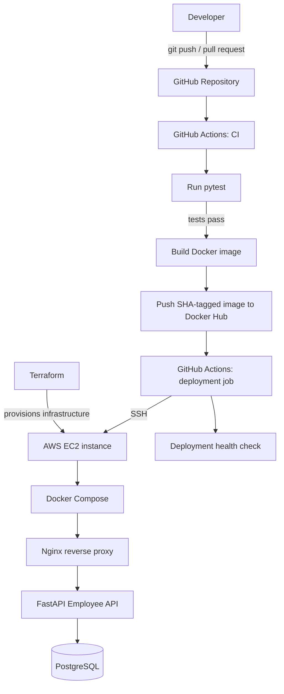

# Employee API — DevOps CI/CD Project

A production-style DevOps learning project that demonstrates how to test, containerize, publish, deploy, and roll back a FastAPI application using GitHub Actions, Docker, Docker Hub, AWS EC2, Docker Compose, Nginx, PostgreSQL, and Terraform.

> **Project goal:** Build and operate an application delivery workflow from code commit to deployment, with repeatable infrastructure and a path toward safer releases.

## Architecture



## Technology stack

| Technology | Purpose |
|---|---|
| Python + FastAPI | Employee API application |
| Pytest | Automated tests |
| Docker | Package the application into an image |
| Docker Hub | Store and distribute versioned images |
| GitHub Actions | CI/CD automation |
| AWS EC2 | Host the application |
| Terraform | Infrastructure as Code |
| Docker Compose | Run and connect application containers |
| Nginx | Public HTTP entry point and reverse proxy |
| PostgreSQL | Relational database |
| Linux / SSH | Remote server administration and deployment |

## How the project works

1. **Develop:** Update the application and tests locally.
2. **Commit and push:** Push the changes to the configured GitHub branch or open a pull request.
3. **Test:** GitHub Actions installs dependencies and runs `python -m pytest -v`.
4. **Build:** After tests pass, the workflow builds the Docker image.
5. **Publish:** The image is pushed to Docker Hub with a commit-SHA tag, and a `latest` tag may also be updated.
6. **Deploy:** The deployment job connects to EC2 over SSH, pulls the selected image, and recreates the API container with Docker Compose.
7. **Route traffic:** Nginx receives public HTTP traffic and proxies requests to the API on the internal Compose network.
8. **Check health:** The deployment can check the `/health` endpoint to verify the application responds.
9. **Roll back:** A manually triggered rollback workflow can deploy a previously published image by its tag.

Terraform manages the infrastructure lifecycle, while CI/CD manages application releases.

## Repository structure

The exact files may evolve, but the project is organized around these components:

```text
.
├── app/
│   └── main.py                 # FastAPI application and endpoints
├── tests/
│   └── test_api.py             # Automated API tests
├── nginx/
│   └── default.conf            # Nginx reverse-proxy configuration
├── .github/
│   └── workflows/
│       ├── ci.yml              # Tests, image build/push, and configured deployment
│       └── rollback.yml        # Manual rollback to a chosen image tag
├── terraform/
│   ├── main.tf                 # Infrastructure resources
│   ├── variables.tf            # Terraform input variables (if present)
│   ├── outputs.tf              # Terraform outputs (if present)
│   └── user-data.sh            # EC2 bootstrap script (if present)
├── Dockerfile                  # Application image definition
├── docker-compose.yml          # API, Nginx, and PostgreSQL services
├── requirements.txt            # Python dependencies
├── .dockerignore
└── README.md
```

> Adjust this tree to match the files currently committed to your repository. If you created a separate `deploy.yml`, add it under `.github/workflows/` and document whether it is manual or automatic. Avoid maintaining two competing workflows that deploy the same release unintentionally.

## Run locally

### Prerequisites

- Git
- Python 3.13 (or the version used by the project)
- Docker Engine and Docker Compose plugin

### 1. Clone the repository

```bash
git clone https://github.com/<YOUR_GITHUB_USERNAME>/<YOUR_REPOSITORY>.git
cd <YOUR_REPOSITORY>
```

Replace the placeholders with your GitHub username and repository name.

### 2. Run the tests

Create and activate a virtual environment if you want to run the tests outside Docker:

```bash
python -m venv .venv
```

**Windows PowerShell**
```powershell
.\.venv\Scripts\Activate.ps1
```

**Linux / macOS**
```bash
source .venv/bin/activate
```

Install dependencies and run tests:

```bash
python -m pip install -r requirements.txt
python -m pip install pytest
python -m pytest -v
```

### 3. Start the services

```bash
docker compose up -d
docker compose ps
```

If your Compose file references a published image, make sure the required image tag exists and any required environment variables are configured first.

Open these endpoints when the stack is running:

- API documentation: `http://localhost/docs`
- Health check: `http://localhost/health`

Stop the stack:

```bash
docker compose down
```

To stop the containers and also delete the named PostgreSQL volume (this **deletes the local database data**):

```bash
docker compose down --volumes
```

## CI/CD workflow

The GitHub Actions pipeline is designed to:

- Run tests on pushes and pull requests for the configured branches.
- Build the Docker image only after tests pass.
- Publish versioned images to Docker Hub.
- Deploy the selected image to EC2 over SSH.
- Allow a known image tag to be deployed for rollback.

### Required GitHub Actions secrets

Add these under **GitHub repository → Settings → Secrets and variables → Actions**.

| Secret | Purpose |
|---|---|
| `DOCKERHUB_USERNAME` | Docker Hub username |
| `DOCKERHUB_TOKEN` | Docker Hub access token (not your account password) |
| `EC2_HOST` | Current public IP or DNS name of the EC2 instance |
| `EC2_USER` | SSH user, for example `ubuntu` |
| `EC2_SSH_KEY` | Private SSH key used by GitHub Actions to connect to EC2 |

**Security notes**
- Never commit private keys, access tokens, passwords, `.env` files, or cloud credentials.
- Keep private SSH keys in GitHub Actions secrets only.
- The matching public key must be present in the EC2 user's `~/.ssh/authorized_keys`.
- Restrict SSH access to trusted source IPs where possible; for production, consider AWS Systems Manager Session Manager instead of public SSH.
- Do not expose PostgreSQL port `5432` or the API's internal port `8000` publicly. Nginx should be the public entry point.
- Use a secrets manager and least-privilege IAM roles for production workloads.

## Deploying and troubleshooting

Useful commands to run on the EC2 instance:

```bash
# See running services and their status
docker compose ps

# Follow logs for all Compose services
docker compose logs --follow

# Follow API logs only
docker compose logs --follow employee-api

# Follow Nginx logs
docker compose logs --follow nginx

# Pull the configured API image
docker compose pull employee-api

# Recreate the API container using the configured image
docker compose up -d employee-api

# Confirm which image the container is using
docker inspect employee-api --format '{{.Config.Image}}'

# Check the application through Nginx from the EC2 instance
curl -fsS http://localhost/health
```

If the instance is recreated, its public IP may change. Update the `EC2_HOST` GitHub secret or automate the address using a stable endpoint. Verify that the EC2 security group allows inbound HTTP on port `80`, and that the application is healthy before troubleshooting the browser URL.

## Infrastructure with Terraform

Terraform provisions the cloud resources defined in the `terraform/` directory. The exact commands depend on the files and backend configuration in your repository.

From the Terraform directory:

```bash
terraform init
terraform fmt -check
terraform validate
terraform plan
terraform apply
```

Review the plan before applying it. `terraform apply` can create billable AWS resources.

**State and lab-account warning:** Do not keep Terraform state only in a temporary directory such as `/tmp`; it can be lost. Store Terraform code in Git and configure a suitable remote state backend when the AWS account and permissions support it. Lab credentials may expire, and lab resources may be deleted automatically. Never commit `terraform.tfstate`, `.tfvars` files containing secrets, or AWS credentials.

To remove infrastructure, use `terraform destroy` only when you intentionally want to delete the resources and have verified the correct workspace and state.

## Current scope and future improvements

This project is intended to grow incrementally. Potential next steps include:

- Add deployment health verification and automatic rollback if a release fails.
- Consolidate deployment logic into one clearly defined workflow.
- Use immutable image tags for releases and avoid relying on `latest` for deployment decisions.
- Store Terraform state remotely and improve infrastructure reproducibility.
- Replace lab credentials with short-lived credentials and least-privilege IAM.
- Add centralized metrics, dashboards, alerts, and log aggregation.
- Add HTTPS with a domain name and TLS certificate.
- Improve database backup, migration, and secret-management practices.
- Evolve the deployment toward Kubernetes, Helm, and GitOps after the EC2 workflow is reliable.

## Learning outcomes

By building this project, you practice:

- Git-based change management
- Automated testing in CI
- Docker image creation and versioning
- Artifact publishing to a container registry
- SSH-based deployment automation
- Infrastructure as Code with Terraform
- Multi-container application deployment
- Reverse proxying and service networking
- Health checks, troubleshooting, and rollback concepts
- Cloud and deployment security fundamentals

## Disclaimer

This is a hands-on learning project, not a claim of production readiness. Before using a similar design in production, review access control, secrets, TLS, monitoring, backup and recovery, availability, patching, and deployment rollback behavior.

---

**Built as a DevOps portfolio project:** from code commit to a versioned container deployed on AWS.
